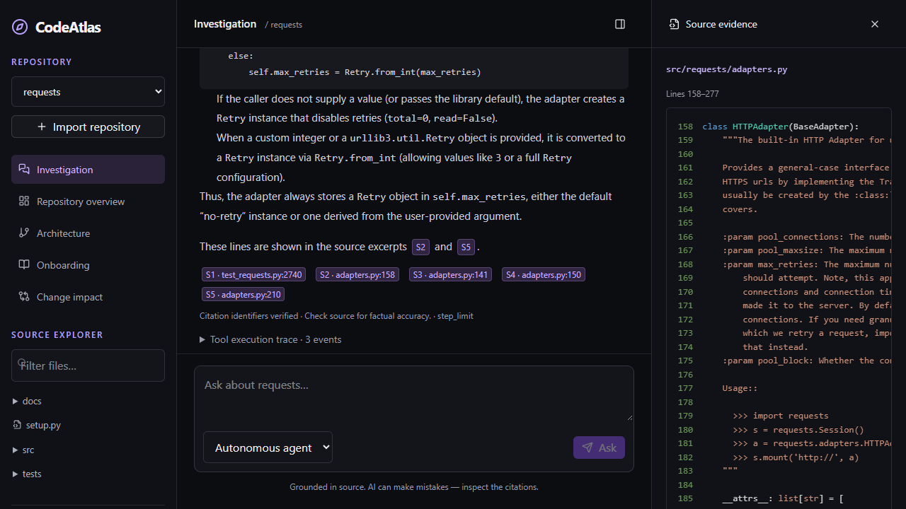
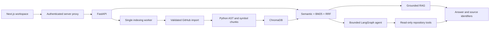

# CodeAtlas

**Navigate code. Discover connections.**

CodeAtlas helps developers enter unfamiliar Python codebases. Ask a question, inspect the implementation behind the answer, and explore how modules connect. It combines the original intelligence engine with a Next.js workspace and FastAPI service.



## Capabilities

- Public GitHub import with background indexing and progress.
- Python file explorer, numbered source, and import inspection.
- Hybrid semantic/BM25 retrieval and reciprocal rank fusion.
- Standard RAG and bounded LangGraph investigations with validated read-only tools.
- Clickable source citations and completed tool execution traces.
- React Flow static architecture graphs, repository statistics, and onboarding heuristics.
- Previous-commit import impact where local history permits; shallow imports display an unavailable state.
- Repository catalog removal and current-index clearing; public clones remain cached locally.

This is a single-owner workspace, not a multi-tenant SaaS. Production requires authentication. Trusted Python callers can still ingest local directories; the public API cannot.

## Local setup

Use Python 3.12+, Node.js 24, Git, and the existing `.venv`. Keep your existing `.env`; copy `.env.example` only when creating a new configuration.

```powershell
.venv/Scripts/python.exe -m pip install -e ".[dev]"
ollama pull nomic-embed-text
.venv/Scripts/python.exe -m uvicorn codeatlas.api.app:app --host 127.0.0.1 --port 8000
```

Configure `LLM_PROVIDER=ollama`, `CHAT_PROVIDER=groq`, and your own `GROQ_API_KEY` in `.env`. Alternatively use `CHAT_PROVIDER=ollama` with a local chat model. OpenAI-compatible providers remain supported. Provider quotas apply; do not enable paid inference unintentionally.

In another terminal:

```powershell
cd frontend
npm ci
npm run dev
```

Open **http://127.0.0.1:3000**. API docs: http://127.0.0.1:8000/docs.

If using local backend authentication, set matching `API_TOKEN` in `.env` and `CODEATLAS_API_TOKEN` in `frontend/.env.local`. The server-only `CODEATLAS_API_URL` defaults to `http://127.0.0.1:8000`. Production additionally requires `FRONTEND_PASSWORD` with at least 16 characters. Never prefix secrets with `NEXT_PUBLIC_`.

## System architecture



The agent retrieves initial evidence, selects validated tools when needed, and generates a bounded final answer. Hosted-provider failures are handled gracefully. Citation validation checks identifier membership, **not factual accuracy**. Static import edges are not runtime call relationships.

The original AST, chunking, retrieval, provider composition, and LangGraph engine are preserved. Integration changes add resource budgets, optional CPU ONNX embeddings, and normalization of model citation typography. Unknown citation IDs still fail validation.

## API

When configured, `/api/*` requires `Authorization: Bearer <API_TOKEN>`. Errors contain an `error` object.

| Method | Route | Purpose |
| --- | --- | --- |
| GET | `/health` | Process health |
| GET | `/api/readiness` | Provider configuration, not verified inference |
| GET / POST | `/api/repositories` | Catalog / import `{ "url": "https://github.com/psf/requests" }` |
| GET | `/api/jobs/{id}` | Job progress; jobs expire on restart |
| GET | `/api/repositories/{id}/tree` | Indexed Python paths |
| GET | `/api/repositories/{id}/source?path=src/example.py&start=1` | Up to 120 source lines and imports |
| GET | `/api/repositories/{id}/overview` | Statistics, graph, onboarding |
| GET | `/api/repositories/{id}/impact` | Previous-commit static import impact |
| POST | `/api/repositories/{id}/questions` | `{ "question": "…", "mode": "rag" }` or `"agent"`; optional bounded history |
| DELETE | `/api/repositories/{id}` | Remove catalog entry and clear current index |

## Verification

```powershell
.venv/Scripts/python.exe -m ruff check .
.venv/Scripts/python.exe -m ruff format --check .
.venv/Scripts/python.exe -m pytest -q
cd frontend
npm run lint
npm run build
```

With both servers, embeddings, and chat provider running, opt into real browser integration checks:

```powershell
$env:E2E_LIVE='1'
$env:E2E_AI='1'
npm run test:e2e
```

Local Playwright uses installed Chrome; CI installs Chromium. CI checks Python quality, frontend lint/build, and the provider-independent landing-page browser test. See [actual verification results](docs/verification.md).

## Deployment and limits

[Deployment instructions](docs/deployment.md) cover Vercel (`frontend` root), Docker, and an explicit free-plan Render blueprint. [Security notes](docs/security.md) describe safeguards and remaining limits. **No full production deployment is verified yet.** A working public URL will be added after frontend/backend smoke tests.

FastEmbed CPU embeddings work without Ollama and use separate collection identities, preventing silent mixing with nomic embeddings. Install with `pip install -e ".[cloud]"` and select `LLM_PROVIDER=fastembed` plus a separate `CHAT_PROVIDER`. The small model's code retrieval quality has not been benchmarked here.

Free Render storage is ephemeral: catalog, indexes, jobs, and downloaded models may disappear after restarts. Jobs are in-process; run one backend worker. Rate limits are process-local. Cold starts and free-host memory fit require deployment testing; durable, always-on zero-cost hosting is not promised.

Future work: durable jobs/storage, user isolation, streamed tool events, broader language parsing, deeper import resolution, and measured retrieval/factual-answer evaluation.

## License

This project is licensed under the MIT License. See [LICENSE](LICENSE) for details.

UI attribution: [third-party notices](frontend/THIRD_PARTY_NOTICES.md).
